# Bộ skill video PipelineX

Cập nhật ngày 27/11/2026. Mỗi skill nằm trong một thư mục riêng dưới `skills/`, với `SKILL.md`, cấu hình hiển thị và tài nguyên đi kèm nếu có. Nội dung workflow giữ nguyên tiếng Anh. Hướng dẫn cài đặt này dùng tiếng Việt.

[](https://skills.sh/danhthanh4182/pipelinex-video-skills)


## Mục lục

- [Cài bằng Skills CLI](#cài-bằng-skills-cli)
- [Kiến trúc tuyến sản xuất](#kiến-trúc-tuyến-sản-xuất)
- [Cấu trúc repo](#cấu-trúc-repo)
- [Danh sách 75 skill](#danh-sách-75-skill)
  - [Điều phối & sản xuất của kênh](#điều-phối--sản-xuất-của-kênh)
  - [Remotion](#remotion)
  - [GSAP & animation web](#gsap--animation-web)
  - [Kỹ thuật motion & mẫu](#kỹ-thuật-motion--mẫu)
  - [Dựng cảnh, hiệu ứng & hậu kỳ](#dựng-cảnh-hiệu-ứng--hậu-kỳ)
- [Giấy phép](#giấy-phép)
- [Thêm skill mới](#thêm-skill-mới)

## Cài bằng Skills CLI

Chạy trong thư mục dự án để cài cả 75 skill cho Codex.

```sh
npx skills add danhthanh4182/pipelinex-video-skills --skill '*' --agent codex --yes
```

Cài riêng skill điều phối PipelineX.

```sh
npx skills add danhthanh4182/pipelinex-video-skills --skill pipelinex-video-studio --agent codex --yes
```

Xem danh sách trước khi cài hoặc kiểm tra các skill đã cài.

```sh
npx skills add danhthanh4182/pipelinex-video-skills --list
npx skills list
```

Lệnh dùng được trong PowerShell và WSL. Thêm `--global` nếu muốn cài cho mọi dự án của môi trường đang chạy. Mở dự án trong Codex và gọi `$pipelinex-video-studio` để bắt đầu. [Tài liệu Skills CLI](https://www.skills.sh/docs/cli)

## Kiến trúc tuyến sản xuất

Các skill trong repo xếp theo đúng các chặng của tuyến sản xuất video của kênh Điểm Tin Công Nghệ. Skill điều phối `pipelinex-video-studio` (và bản vận hành cho kênh `san_xuat_video_kinetic`) gọi các nhóm skill còn lại theo chặng:

```mermaid
flowchart LR
    A["Bài đã duyệt<br/>News Studio"] --> B["Điều phối<br/>pipelinex-video-studio"]
    B --> C["Kịch bản & phân cảnh<br/>direct-video-motion · build-code-explainers<br/>iart-video-briefs · analyze-video-references"]
    C --> D["Giọng đọc<br/>TTS + căn mốc từ (Whisper)"]
    D --> E["Dựng hình<br/>Remotion · HyperFrames · GSAP"]
    E --> F["Kỹ thuật motion<br/>iart packs · open-motion-techniques<br/>kinetic-typography · caption-animation"]
    F --> G["Kiểm duyệt QC<br/>stills · Motion Critique"]
    G --> H["Hậu kỳ & giao file<br/>deliver-video-with-ffmpeg"]
    H --> I["Đăng đa kênh<br/>YouTube · Facebook · Instagram<br/>Threads · TikTok · Bluesky"]
```



## Cấu trúc repo

```text
pipelinex-video-skills/
├── README.md             # Tài liệu này
├── SKILLS.md             # Mục lục đầy đủ kèm giấy phép từng skill
├── IART-ATTRIBUTION.md   # Ghi nhận nguồn các pack iart-ai
└── skills/
    └── <ten-skill>/
        ├── SKILL.md      # Nội dung workflow của skill
        ├── SOURCE.md     # Nguồn gốc của skill
        └── ...           # LICENSE, tài nguyên, scripts đi kèm nếu có
```

## Danh sách 75 skill

### Điều phối & sản xuất của kênh

| Skill | Công việc |
| --- | --- |
| `pipelinex-video-studio` | Điều phối dựng và kiểm duyệt trong PipelineX |
| `san_xuat_video_kinetic` | Quy trình chính thức sản xuất video Kinetic Explainer cho kênh Điểm Tin Công Nghệ: kịch bản, giọng đọc, render, QC và đăng |
| `ask-emil` | Bộ định tuyến: hỏi skill hoặc flow nào hợp với tình huống |
| `analyze-video-references` | Tách cảnh và phân tích video tham chiếu, dựng storyboard gốc |
| `rea-video` | Phân tích ngược một video: quay thật / AI / 3D / hoạt hình, các lớp hậu kỳ và phương án làm lại |
| `ky_thuat_mau_diepykien` | Kỹ thuật motion graphics chưng cất từ video mẫu của @diepykien, tích hợp dạng opt-in vào template Kinetic |
| `muse-video` | Tạo ảnh và video AI 10 giây có tiếng bằng Meta Muse qua API useapi.net |
| `muse-video-skill` | Lên ý tưởng, kịch bản và phân cảnh cho dự án video trên Muse (tiền kỳ, không render) |
| `muse-video-prompt-skill` | Quy trình prompt cho Muse Video: mẫu prompt 6 phần, nối nhiều đoạn, kiểm chứng từng khung hình |
| `muse-animated-short-film` | Dựng phim hoạt hình ngắn trọn gói trên Muse AI: character sheet, story bible, keyframe, lồng tiếng, ghép phim |

### Remotion

| Skill | Công việc |
| --- | --- |
| `remotion-video` | Dựng video bằng Remotion: composition React, render MP4/GIF từ code |
| `remotion-video-templates` | Dựng video bằng React và Remotion: mẫu JSON-driven cho tin tức, Shorts, explainer, phụ đề |
| `remotion-create` | Tạo dự án Remotion mới |
| `remotion-render` | Xuất video, ảnh tĩnh hoặc timeline OpenTimelineIO từ Remotion |
| `remotion-studio` | Xem trước bằng Remotion Studio |
| `remotion-captions` | Tạo, hiển thị và animate phụ đề trong Remotion |
| `remotion-maps` | Hoạt hình bản đồ trong Remotion |
| `remotion-elements` | Cài Elements: component dựng sẵn (tiêu đề, nền, biểu đồ, kiểu phụ đề) vào dự án Remotion |
| `remotion-interactivity` | Cấu trúc markup để sửa lớp, timing và style ngay trong Remotion Studio |
| `remotion-markup` | Thực hành tốt cho nội dung, animation và hiệu ứng trong markup Remotion |
| `remotion-multimedia` | Làm việc với Mediabunny trong Remotion |
| `remotion-best-practices` | Bộ định tuyến cho toàn bộ skill Remotion |
| `remotion-docs` | Tra cứu tài liệu Remotion |
| `remotion-license` | Thông tin giấy phép Remotion và cách mua |
| `remotion-saas` | Xây ứng dụng có Remotion |
| `remotion-upgrade` | Nâng cấp Remotion và các gói liên quan |

### GSAP & animation web

| Skill | Công việc |
| --- | --- |
| `gsap-core` | GSAP lõi: tween, easing, stagger, matchMedia cho responsive và reduced-motion |
| `gsap-timeline` | GSAP Timeline: sắp xếp thứ tự, lồng timeline, điều khiển phát |
| `gsap-scrolltrigger` | ScrollTrigger: animation theo cuộn, pin, scrub, parallax |
| `gsap-plugins` | Các plugin GSAP: Flip, Draggable, SplitText, ScrambleText, SVG và vật lý |
| `gsap-utils` | gsap.utils: clamp, mapRange, interpolate, random, snap, toArray |
| `gsap-react` | GSAP trong React/Next.js: useGSAP, context, dọn dẹp khi unmount |
| `gsap-frameworks` | GSAP trong Vue, Svelte và các framework ngoài React |
| `gsap-performance` | Tối ưu hiệu năng GSAP: ưu tiên transform, tránh layout thrashing, giữ 60fps |
| `bo_cong_cu_animation_web` | Bộ thư viện animation web đã kiểm chứng (anime.js và các thư viện kèm theo) cho không gian, trang web và sản phẩm video |
| `hyperframes-video-templates` | Dựng bản xem trước bằng HTML, CSS và GSAP với HyperFrames |

### Kỹ thuật motion & mẫu

| Skill | Công việc |
| --- | --- |
| `after-effects` | After Effects: expression, rig, MOGRT, xuất bản (kênh alpha, codec), xử lý chậm/treo, tổ chức dự án |
| `animated-infographic` | Infographic động: bố cục, hiện từng phần theo trình tự, icon, số đếm, đường nối |
| `animation-principles` | Nguyên tắc chuyển động tự nhiên: easing, overshoot, timing, stagger — nền tảng không phụ thuộc công cụ |
| `audiogram` | Audiogram: biến podcast/audio thành video sóng âm, thanh tần số và phụ đề đồng bộ |
| `beat-sync-editing` | Cắt dựng theo nhịp: khớp nhịp nhạc/BPM, match cut, J-cut/L-cut, speed ramp |
| `caption-animation` | Phụ đề động: timing từng từ bằng Whisper, highlight từ đang đọc, karaoke, vùng an toàn 9:16 |
| `chart-animation` | Biểu đồ động từ dữ liệu: bar chart race, CSV thành video, bộ đếm số, xếp hạng theo thời gian |
| `color-motion` | Màu trong chuyển động: palette, gradient, nội suy OKLCH, chấm màu và quản lý màu khi render |
| `countdown-video` | Video đếm ngược: timer chính xác từng frame, hiệu ứng số lật/lăn, nền lặp |
| `diagram-animation` | Animate sơ đồ: flowchart, sơ đồ kiến trúc/tuần tự hiện từng bước, dữ liệu chảy theo đường nối |
| `explainer-video` | Video explainer 30–90 giây: kịch bản, storyboard, dựng cảnh, đồng bộ lời đọc và phụ đề |
| `iart-video-briefs` | Viết brief cho motion graphics và video dữ liệu bằng iArt.ai |
| `isometric-animation` | Animation isometric 2.5D: cảnh iso, infographic iso, sơ đồ tách lớp |
| `kinetic-typography` | Chữ động: reveal theo ký tự/từ/dòng, chữ chạy trên đường path, font biến thiên, title card |
| `logo-animation` | Animate logo: intro/stinger, brand reveal, vẽ nét SVG, đồng bộ nhạc hiệu |
| `lower-thirds` | Lower third và overlay phát sóng nền trong suốt (WebM alpha / ProRes 4444) cho OBS và phần mềm dựng |
| `lower-thirds-tiktok` | Lower third động: thẻ tên/chức danh, mẫu hoá cho danh sách nhiều người |
| `map-animation` | Hoạt hình bản đồ kiểu Vox: zoom, vẽ tuyến đường, ghim điểm, highlight vùng |
| `motion-art-direction` | Chỉ đạo nghệ thuật chuyển động: ngôn ngữ motion, tông và nhịp, nhất quán giữa các cảnh |
| `motion-background` | Nền động: mesh gradient, shader aurora, hạt sao, vòng lặp liền mạch |
| `motion-design` | Nguyên lý motion design: timing, easing, vũ đạo chuyển động và nguyên tắc Disney cho UI |
| `open-motion-techniques` | Kỹ thuật OpenMotion chưng cất cho pipeline Remotion: Motion Critique, Variation Engine, kể chuyện 5 hồi |
| `presentation-video` | Biến deck/slide thành video có lời đọc, các lớp hiện theo nhịp thuyết trình |
| `short-form-video` | Video ngắn dọc: hook 3 giây đầu, giữ chân người xem, vòng lặp, vùng an toàn 9:16 |
| `shot-composition` | Bố cục khung hình: lưới, điểm nhấn, vùng an toàn, chuyển động camera 2D/3D |
| `talking-head-b-roll` | Thêm motion graphics B-roll cho video talking-head theo đúng nội dung lời nói |
| `text-message-animation` | Video hội thoại tin nhắn: bong bóng chat, chỉ báo đang gõ, render từ dữ liệu |
| `whiteboard-animation` | Whiteboard vẽ tay: nét SVG tự vẽ, bàn tay đi theo đầu bút, chuyển cảnh xoá bảng |
| `wrapped-video` | Video kiểu Spotify Wrapped: tổng kết dữ liệu cá nhân hoá, render hàng loạt từ bảng dữ liệu |
| `youtube-intro-outro` | Intro/outro YouTube: sting 3–5 giây, end screen 20 giây cuối trong vùng an toàn phần tử |

### Dựng cảnh, hiệu ứng & hậu kỳ

| Skill | Công việc |
| --- | --- |
| `build-3d-video-shots` | Dựng cảnh 3D bằng Three.js và Blender |
| `build-code-explainers` | Dựng video giải thích có lời đọc và thanh chương |
| `build-video-effects` | Dựng hiệu ứng bằng EffectCraft và PixelFX |
| `deliver-video-with-ffmpeg` | Chuyển mã và kiểm tra tệp video bằng FFmpeg/FFprobe |
| `direct-continuous-launch-videos` | Dựng video sản phẩm với chuyển động liền mạch |
| `direct-video-motion` | Lập storyboard và chỉ đạo chuyển động |
| `generate-comfyui-video-assets` | Chuẩn bị workflow tạo tư liệu bằng ComfyUI |
| `produce-screen-demo-video` | Quay và biên tập demo bằng OpenScreen |
| `render-raea-video` | Thử dựng cảnh GPU bằng Raea |

Gói gồm các skill và tài nguyên của chúng. Các template mã nguồn PipelineX và ứng dụng bên thứ ba dùng bản phân phối riêng.

## Giấy phép

Mỗi skill giữ giấy phép gốc của nó — xem cột giấy phép trong [SKILLS.md](SKILLS.md) và file `SOURCE.md` / `LICENSE` trong thư mục từng skill. Ghi nhận nguồn các pack iart-ai: [IART-ATTRIBUTION.md](IART-ATTRIBUTION.md).

## Thêm skill mới

1. Skill phải có `SOURCE.md` ghi rõ nguồn gốc và file `LICENSE` nguyên văn của nguồn; nguồn không rõ thì không nhận.
2. Thêm thư mục vào `skills/`, cập nhật mục lục [SKILLS.md](SKILLS.md) và bảng danh sách trong README này (kèm số lượng tổng).
3. Đẩy lên bằng cùng quy trình đồng bộ của repo và đọc lại từ GitHub để kiểm chứng.
